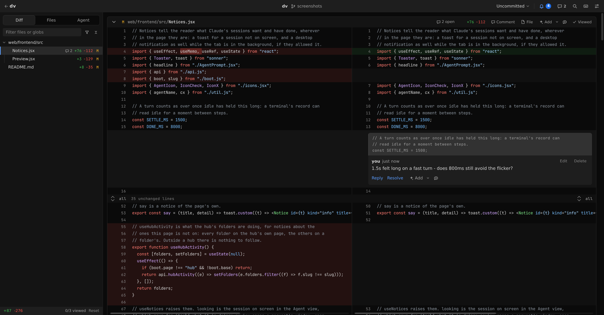
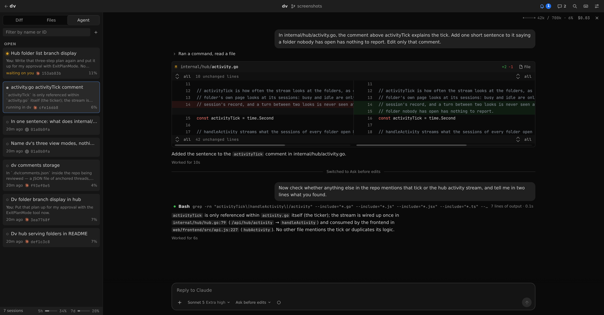
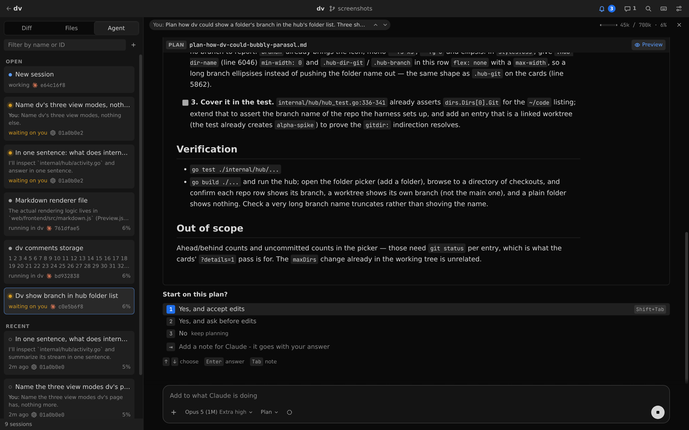
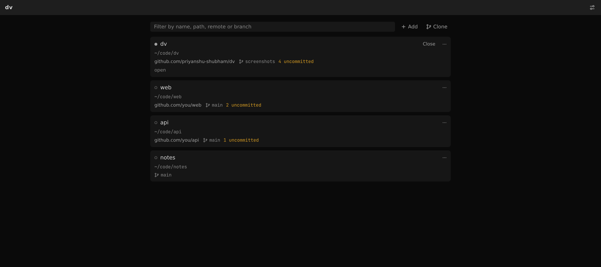

# dv

A local place to review code and work with Claude Code, in the browser - a
phone's too.

- **Diff** - your changes, a branch, any commits or a pull request as GitHub
  shows it - nothing checked out - with comments on any line
  that can be added to a message for Claude. Markdown takes them read
  rendered as well, and any file takes one on the file itself - a picture or
  something binary included.
- **Files** - the whole repository, or any branch or commit, to read and
  comment on.
- **Agent** - Claude Code's sessions beside the code, on Claude or on the GPT
  models of your Codex sign-in: their edits
  show as diffs you can comment on, the comments go with your next message, and
  their permission prompts are answered in the page. A plan comes up for
  approval with its lines open to comments. A message starting with `!` runs
  in your shell, as in the terminal, and the agent is sent what it printed.
  A reply can show a picture, video, PDF or a web page the agent made, live
  in place.
- **Terminal** - shells in the folder, listed with what each is running and
  where. Ctrl+` brings it up from anywhere, and back. The shells are dv's, not
  the page's: a reload, or the page on another device, finds them as they
  were, and they end when closed, on `exit`, or when dv stops. A terminal on
  a tmux session attaches to it again when dv next opens the folder, the
  sidebar lists the sessions none shows, to open one, and what tmux or another
  program copies reaches the browser's clipboard. On a phone, a row of keys
  holds Esc, Tab, Ctrl, Alt and the arrows, a finger scrolls, pinches and picks
  text to copy or ask a session about, and a terminal can tell you when its
  command finishes. Not on Windows yet.

Run `dv` in a git repository and it prints a URL. Comments are kept in a file
inside the repository that git never sees. Outside git, the same page opens on
the folder's files, without the diff.

```
$ cd ~/code/my-project
$ dv

  my-project — reviewing /home/you/code/my-project
  http://127.0.0.1:41207
  comments → /home/you/code/my-project/.dv/comments.json

  ctrl-c to stop
```

`dv hub` serves many folders from one address instead, with a page to add
folders, clone repositories and make worktrees - see [Hub](#hub).

In a folder's page, `?` lists the keyboard shortcuts.

## Screenshots

Your changes, side by side, with a comment left on the lines it is about.



Claude Code beside the code: what it ran folded away, the edit it made as a
diff to read and comment on, and how long each turn took. Down the side, the
sessions of both agents - working, waiting on you, or done.



A plan comes up as the document it is, its steps open to comments that go with
your answer.



`dv hub` holds many folders on one address, each saying what it is doing.



## Install

```
curl -fsSL https://raw.githubusercontent.com/priyanshu-shubham/dv/main/install.sh | sh
```

That fetches the latest release for your machine — Linux or macOS, x86-64 or
ARM — checks it against the release's checksums, and puts `dv` in
`~/.local/bin`. `DV_VERSION=v0.2.0` pins a release and `DV_INSTALL_DIR` picks
another directory. On Windows, take the zip from the
[releases page](https://github.com/priyanshu-shubham/dv/releases).

dv needs `git` for the diff, and the `claude` CLI on your PATH for the Agent
view; the `codex` CLI, signed in with ChatGPT, adds its models. `rg` is used for text search when present, with a built-in scanner as the
fallback.

To build it yourself: `make install`, with Go 1.24+, Node and pnpm.

A running dv picks up a newly installed one with Settings → Restart, or
`curl -X POST -H 'Content-Type: application/json' <dv's address>/api/restart`.

## Hub

```
$ dv hub

  dv hub — 3 folders
  http://127.0.0.1:41000

  ctrl-c to stop
```

`dv hub` is one dv for many folders on one port: each folder's page is at
`/<name>/`, so a single address - or a single tunnel to a phone - reaches all of
them. `dv` in a folder a hub is serving prints the hub's address for it and
exits, and `dv hub` with a hub already on the port opens that one. An agent
that finishes, or wants an answer, is told of wherever you are: on another
folder's page or on the hub's own, named by its folder.

- `-host 0.0.0.0` reaches the hub from other devices on your network, where
  **anyone who can reach the port can add folders, clone, run Claude in them,
  and open a shell**.
  Over plain http from another device, browsers allow neither desktop
  notifications nor pasting a copied image; a tunnel with https gives both.
- Clones use your own git credentials and never stop to ask for a password or a
  host key, so one that needs either fails and says why.
- A Claude Code session in a cloned repository uses that repository's own
  settings and hooks, so clone what you trust.
- Worktree hooks are kept in the hub, never committed to the repository.
- A repository's worktrees know each other. The branch menu lists the other
  worktrees and opens one's page, adding it to the hub if need be; Go to
  folder lists them first, by branch; and the Agent view shows their sessions
  under Worktrees, apart from other folders'. **Finish…** in a worktree's
  branch menu merges its branch into what the main checkout has (a conflict
  is undone), runs the teardown hook, deletes the worktree and, if asked, its
  merged branch, listing the commits it would merge.
- **Task** starts a one-off task in a new folder of its own - a fresh git
  repository in dv's data folder (`~/.local/share/dv/tasks` on Linux) - and
  opens it on the Agent view. Closing the task stops its sessions and deletes
  the folder with everything in it.

## Flags

```
-C <dir>      repository to review (default: the current directory)
-port <n>     port to listen on (default: one derived from the repository's path,
              in 41100-41999, so each repository keeps its own URL)
-host <addr>  address to bind (default: 127.0.0.1)
-no-open      don't open a browser
-version      print the version
```

`dv hub` takes `-port` (default 41000), `-host` and `-no-open`.

`dv reset` deletes the review — every comment and viewed mark — after asking.
`-y` skips the question, and is needed when stdin is not a terminal.

`dv comment <file>[:line[-end]] "message"` adds a comment to the review, the
same as leaving one in the page. It's meant for agents: an action can ask
Claude or Codex to review the diff and leave each finding as a comment. It
works whether or not dv is running, and the page shows new comments as they
arrive. Without a line the comment is on the whole file; without a message
it reads one from stdin; `-old` is for a line the change removed. See
`dv comment -h`.

`dv note "title"` adds a note to the repository's notes, the list beside the
comments (the header's comments button, then **Notes**) for what is to be
done later. A note has a status (open, doing, done), a priority and labels,
and every worktree of the repository shares the list. The first line of the
message is the title and the rest is Markdown under it; `-p high|medium|low`
sets the priority and `-l a,b` the labels. From the page a note can be sent
to a session's message box. See `dv note -h`.

Beside them, **Pad** is a scratch pad of your own: free text, saved as you
type, and the same in every folder and on every device. The header's pad
button or Alt+P opens it from anywhere, the message box too, and Alt+P again
goes back to where you were; on a phone, a session's bar has a button for it.

## What dv keeps, and where

In the repository, in `.dv/` at its root:

- `comments.json` — the comments
- `viewed.json` — files marked viewed, per comparison
- `prefs.json` — the file filters, unsent messages to Claude and what is added
  to them, half-answered questions
- `agent.json` — the sessions open in dv, rewinds not yet sent, where you changed a session's permission mode, and the model and effort
  picked for each Claude session
- `server.json` — the address of the dv running here

On first run dv adds `/.dv/` to `.git/info/exclude`, so none of it shows in
`git status` or gets committed, and your `.gitignore` stays untouched. Outside
git there is nothing to add it to, so ignore `.dv/` yourself.

The notes are the repository's, not a worktree's, so they live in `.git/dv/`
(the main checkout's, which its worktrees share) as `notes.json`; outside git,
in `.dv/`.

In your config folder (`~/.config/dv` on Linux): `prefs.json`, the settings that
follow you to every repository and device - theme, code colours, sidebar side,
context, Markdown previews, whether added-to sessions start temporary, the pad - and
`hub.json`, the hub's folders. What suits one
screen - split or unified, wrapping, panel widths, desktop notifications - stays
in the browser.

The comments file is meant to be handed to an agent along with "address these":

```json
{
  "format": 1,
  "repo": "my-project",
  "threads": [
    {
      "id": "t_9f2c...",
      "file": "internal/server/handlers.go",
      "side": "new",
      "startLine": 88,
      "endLine": 91,
      "quote": ["\tif err != nil {", "\t\treturn err", "\t}"],
      "scope": "Uncommitted",
      "baseSha": "fa4ae86",
      "resolved": false,
      "comments": [{ "id": "c_1a...", "author": "you", "body": "this swallows the cause" }]
    }
  ]
}
```

`quote` holds the lines the thread was attached to, so a comment can still be
found after the code under it moves. When the text selected to write it was
less than those lines, `excerpt` holds that text.

## Rules the page applies

**Generated files** are listed but their diff is not shown until asked for. A
file counts as generated if its path says so (lock files, `vendor/`,
`node_modules/`, `*.pb.go`, `*.min.js`, `__snapshots__/` and the like), if its
first lines carry a `generated … do not edit` banner, or if `.gitattributes`
marks it `linguist-generated`, which overrules the guesses.

**Include and exclude** take comma-separated globs. A pattern without a slash
matches a file or folder name anywhere, one with a slash is anchored at the
repository root, and a folder takes everything inside it.

**Go to definition** is built into dv, from the files git tracks, with nothing
to install: Cmd+click a name on a Mac, Ctrl+click elsewhere, or double tap it
on a phone. It knows Go, JavaScript and TypeScript, Python, Rust, Ruby, Java,
Kotlin, Scala, C#, C, C++, Objective-C, PHP, shell, SQL, Protocol Buffers,
Terraform and HCL, CSS, Elixir, Lua and Swift, plus Makefile targets and
Markdown headings.

**Files in replies**: dv tells Claude that a line of ``
shows that file in the reply - a picture, video, sound, PDF or HTML page - and
to make a page when something comes across better interactively than as text.
The path is absolute or from the folder. A page runs as part of dv, loads what
sits beside it by relative path, and reloads when the file changes. Text
selected in it quotes in a reply as the agent's own does, with the file going
along. **Show files in replies**, in Settings, stops telling them.

**Outside git**, the file listing leaves out `node_modules`, `.venv`,
`__pycache__`, `.cache` and version control's folders, and stops at 50,000
files.

## Claude Code

dv runs sessions through the `claude` CLI, with your Claude Code settings and
login; `/login` does not work from dv, so log in from a terminal. A session open
in a terminal can be read in dv but not written to, since two writers would fork
its transcript.

**Prompts from terminal sessions**, in Settings, lets sessions running in a
terminal ask for permission in dv too. It adds three hooks to
`~/.claude/settings.json` (or `$CLAUDE_CONFIG_DIR`), beside any you have. Each
runs `dv claude hook`, which does nothing when no dv is open on the session's
repository, so Claude Code behaves as always elsewhere. If dv moves, the next dv
to start points the hooks at itself. **Turn the setting off before removing
dv**, or the hooks are left running a binary that is not there.

## The model gateway

The Claude Code sessions dv starts reach the model through dv itself, at its
own address. A Claude model's requests go on to Anthropic as Claude Code sent
them, with your own login - or to the `ANTHROPIC_BASE_URL` dv was started
with. Sessions running in a terminal are not covered.

**Codex models**: with the `codex` CLI signed in with ChatGPT, the model picker
also lists its GPT models, and a session on one is answered through that
sign-in, in Claude Code's own tools and prompts. Codex's login stays Codex's:
when its token is about to run out, dv has `codex app-server` refresh it. dv
tells Claude Code each model's real context window, and shows no cost for them.
In auto mode, where Anthropic would judge a Claude model's actions, a Codex
model judges a Codex model's, so nothing from those sessions goes to Anthropic;
an action it can't judge is left to you. **Edit the list…** in the picker hides
models you don't use.

An action can also run its prompt with the Codex CLI itself (`codex exec`), in
a sandbox the action picks; its output shows under Actions.

**Masked secrets** are sealed on this computer. Wherever one turns up in what a
session sends - a file read, a command's output, your message - the model is
sent `[[dv-secret:NAME]]` in its place, and the real value is put back in what
it writes, so a command it runs still works. The page shows each as a chip with
a glimpse of the value; hover one to see it, copy it or change it. Add one from
**+** in the message box, **Mask** on selected text, or Settings › Agent, and
use one in a message with `#NAME`. The values in an open folder's `.env` files
are masked as they stand. Text that looks like a secret - a key's shape, a long
random token - and isn't masked holds the request while dv asks whether to mask
it or send it as is; each is asked about once, and one left unanswered for five
minutes is masked. Both are on by default, in Settings › Agent.

## License

MIT — see [LICENSE](LICENSE). The UI ships JetBrains Mono, under the SIL Open
Font License 1.1.
